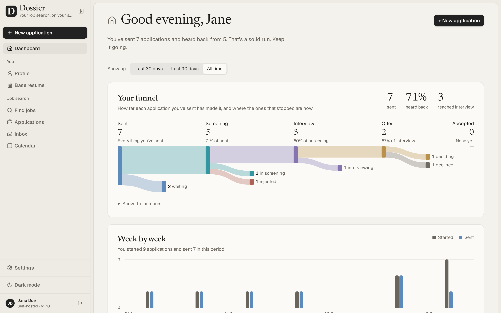
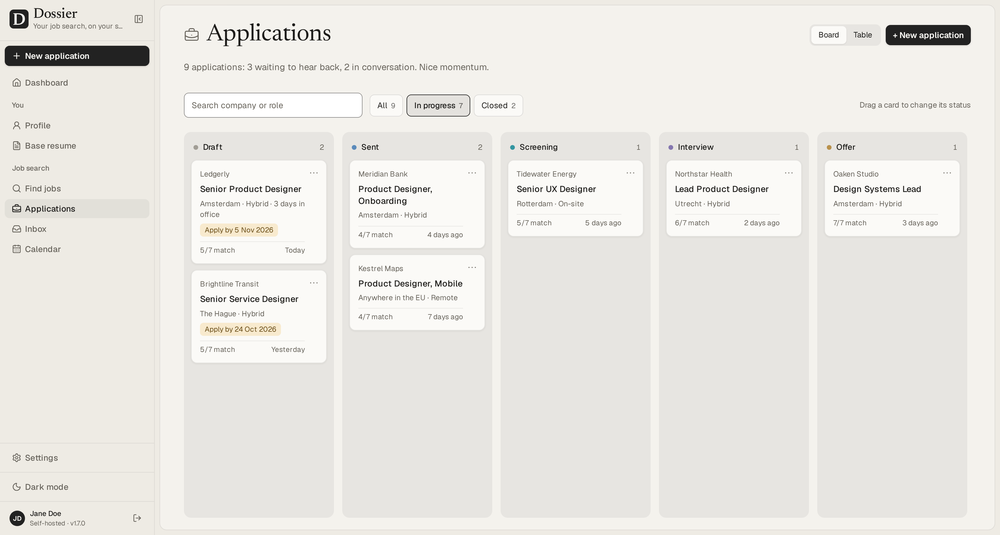
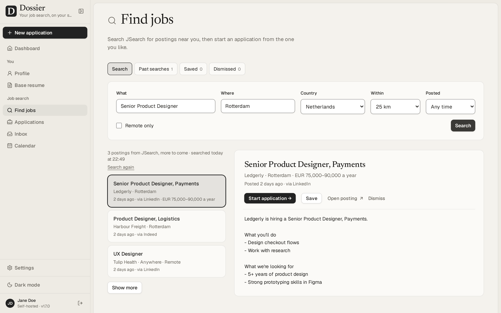
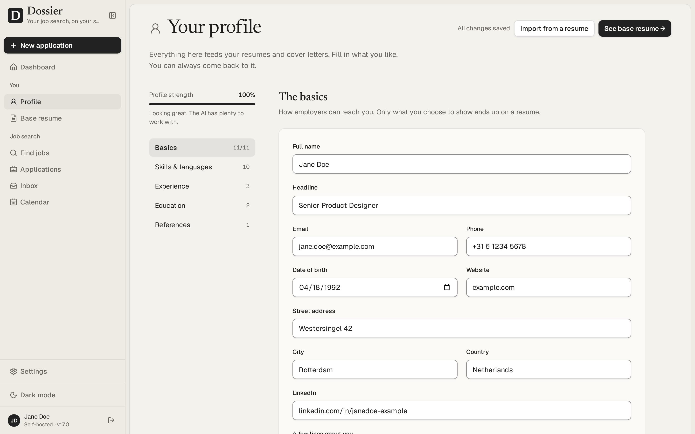

<p align="center">
  
</p>

<h1 align="center">GradTrail</h1>

<p align="center">
  A job search workspace for students and early-career developers around the world.
</p>

This project is a global adaptation of [Dossier by AienTech](https://github.com/AienTech/dossier), an open-source job search and application tracker licensed under AGPL-3.0. It includes India-specific sources alongside sources for other countries and worldwide remote work. The interface's dark, dotted visual direction and vivid green accents take design inspiration from [Off Grid AI](https://getoffgridai.co/).

<p align="center">
  <a href="https://github.com/knowprasad/gradtrail/actions/workflows/ci.yml"></a>
  <a href="LICENSE"></a>
  
  
</p>

GradTrail keeps your career history in one profile and turns it into a clean resume. For every job you apply to, it reads the posting, shows how you match, and drafts a tailored resume and cover letter that only use facts from your profile. You refine them in a chat, download them as PDFs and track each application from draft to offer.

It's for one person on a small server: one password, your data in your own PostgreSQL database, and an AI model of your choice. Use a local model through Ollama or LM Studio to keep your profile and documents on your own hardware, or choose a hosted model (any OpenAI-compatible API, Anthropic or Mistral). A hosted provider receives the information needed to generate your documents; [Privacy](https://github.com/AienTech/dossier/wiki/Privacy) explains what is sent.

**Get started:** [run it on your computer](#run-it-on-your-computer), or [self-host it](#self-hosting) on a server. GradTrail's setup and source instructions are in the docs below. The [Dossier wiki](https://github.com/AienTech/dossier/wiki) covers features shared with the upstream project; GradTrail-specific instructions here take precedence for this fork.

## Demo


<sub>Recorded with the demo data (Jane Doe is made up) and a stand-in AI server that answers at once, played at 1.2× speed. With a real model, reading a posting and writing the documents takes from a few seconds to a few minutes.</sub>

### Walk through the job-search flow

1. On **Find jobs**, open the clearly labeled sample preview to see the results layout before configuring a source. Sample listings are fictional and never shown as live vacancies.
2. Choose a source in **Settings → Job search**. FreeHire, Remote OK, and student feeds work without an API key; AI is optional.
3. Search for a role and choose a country. Open a result to review its source, employer-posted date (or the source's missing-date notice), and the original listing.
4. Save a relevant result or start an application. GradTrail keeps its stages, deadlines, checklists, and follow-ups together.
5. Add projects and coursework to your profile. If you configure AI, it can draft application documents from those facts for you to review.

The animation uses fictional demo data. It is a walkthrough of the workflow, not a live job feed.

## Features

- **Profile and first run:** the dashboard guides a new user through building a profile, choosing a job source, and finding openings; AI is optional for search. Build the profile by hand or import a PDF, Word or Markdown resume with a configured AI provider. Review the extracted details before adding them. Projects (side, open-source, course or thesis work) count alongside formal experience, and the profile strength meter shows what could make the profile more complete.
- **Base resume:** twelve themes and a theme builder, previewed live and printed to PDF on the server. Duplicate themes, or share them as files.
- **Find jobs:** search postings through JSearch (LinkedIn, Indeed and more), Adzuna, FreeHire (company career pages), Jooble (India), USAJOBS (U.S. federal positions), Remote OK, Startup.jobs, student feeds from [InternScan](https://github.com/vishnunandan555/internscan) and [FresherFlow](https://github.com/FresherFlow/India-Jobs-Internships), or the optional Germany-only Bundesagentur für Arbeit source. Start without a key using FreeHire, Remote OK, Startup.jobs, or student feeds; AI is optional. Some other sources require provider credentials. Choose your own country and location; when the profile has no country, the first search asks you to choose one. Narrow by experience, opportunity type, remote status, and posting date; some sources treat these as keyword hints rather than strict filters. Results link to the original post and show the details their source provides, including date, eligibility, pay, duration, and deadline. Missing details are labelled; confirm requirements and current status on the employer's post. Save searches for manual checks or opt into daily new-post alerts for up to five searches; daily checks are off by default and use source requests. See the [source coverage guide](docs/JOB-SOURCES.md).
- **Startups:** hiring leads from YC job posts, Hacker News' current monthly “Who is hiring?” thread, and Startup.jobs. Startup.jobs contributes up to 50 recent feed entries, which can include larger employers as well as startups. No job-search API key is needed for these feeds. Leads are ranked against your profile; open the original listing and decide whom to contact. On refresh, GradTrail may check up to 12 company sites for published role addresses, follows their robots.txt, and never sends a message for you. You can also look for personal addresses on a company's site when you explicitly ask.
- **Job agent (optional):** once a day it runs one search for you, skips what you've seen, scores the new postings against your profile and keeps the best on the Agent screen, with its reasons. It can prepare tailored drafts too, which wait for your review. It never sends or applies. Save any Find jobs query to refresh it later on demand and see how many new postings appeared; this works without a background scheduler.
- **New application:** paste a posting; GradTrail pulls out the details and requirements, matches them against your profile, and writes a tailored resume and cover letter in the tone you pick.
- **Never invents experience:** drafts only use facts from your profile. What the posting asks for and your profile doesn't have is shown as a gap, not made up.
- **Refine:** ask for changes in a chat, edit or regenerate any part (every part of the cover letter too: sender, date, recipient, greeting and sign-off, written in the letter's language), undo AI changes or go back to any earlier version, keep private notes.
- **Send:** an email to go with each application, to whoever the posting says to send it to, ready to copy or open in your mail app, with the resume and cover letter PDFs to attach. Edit, rewrite or refine it like the documents.
- **Claude connector (optional):** use GradTrail from Claude, on claude.ai, in the Desktop and mobile apps or in Claude's command-line app, on your own Claude plan. Claude can search for jobs, score them against your profile, read your profile and applications, and save the resume and cover letter it writes as a Draft, checked like GradTrail's own. It never sends or deletes anything. Without an AI model of GradTrail's own, **Write it with Claude** hands a posting to a new Claude chat. Turn it on in Settings → Claude connector (see [Connecting Claude](https://github.com/AienTech/dossier/wiki/Connecting-Claude)).
- **Gmail and Calendar (optional):** connect your Google account to send an application from your own address with its PDFs attached, see employers' replies next to each application, have the AI read what they ask and draft your answer from your profile, offer interview times you're free, and see your month and the week ahead on the dashboard, with interviews kept in step with Google Calendar both ways. Nothing is sent without your confirmation. Set it up by entering your Google OAuth client in Settings → Google, or with `GRADTRAIL_GOOGLE_CLIENT_ID` and `GRADTRAIL_GOOGLE_CLIENT_SECRET` (see [Connecting Gmail and Calendar](https://github.com/AienTech/dossier/wiki/Connecting-Gmail-and-Calendar)).
- **Track and prepare:** a board and table of applications, private notes and activity history, deadlines, customizable preparation checklists, and editable interview practice prompts with private answer notes. Suggestions use local rules, cost nothing, and are not sent to an AI provider. A dashboard shows your funnel (last 30 days, 90 days or all time), a week-by-week chart, what's worth a look next, upcoming interviews and user-set follow-up reminders. Checklist suggestions can include optional public learning guides from [roadmap.sh](https://roadmap.sh/) when a role or its extracted skills match. Review and edit suggestions against the employer's original instructions. Reminders appear when due or within seven days, and can be marked done from the dashboard; no background scheduler is needed.
- **Your data:** export and import everything as one file, nightly backups, and Delete everything.

## Screenshots



<table>
  <tr>
    <td width="50%"><br>An application: the tailored resume, and a chat to refine it</td>
    <td width="50%"><br>A new application: how you match the posting</td>
  </tr>
  <tr>
    <td><br>Every application on a board, from draft to offer</td>
    <td><br>Find jobs and start an application from a posting</td>
  </tr>
  <tr>
    <td><br>The base resume, with twelve themes and a theme builder</td>
    <td><br>One profile that every resume and letter comes from</td>
  </tr>
  <tr>
    <td><br>Replies from Gmail, read by the AI, with answers it drafts</td>
    <td><br>Your interviews and Google Calendar on the dashboard, kept in step</td>
  </tr>
</table>

<sub>The screenshots show the demo data: Jane Doe is made up.</sub>

## Run it on your computer

Install [Docker Desktop](https://docs.docker.com/desktop/) on Windows or macOS, or Docker Engine with Compose on Linux, and start it. The setup script runs GradTrail from this checkout in Docker using Next.js development mode; it does not use the published production image. On first run, the script asks you to enter and confirm a sign-in password without displaying it, then generates the database password and app secret and writes them to `.env`; you do not need to create a folder or secret files. It stores only a password hash. If `.env` already exists, setup reuses its password and database without prompting again. It waits for the app to become ready and prints the address to open. The first visit to a page may take longer while the development server compiles it.

1. Download or clone this repository and open its folder in a terminal.
2. Run the setup script for your system:

   ```powershell
   .\scripts\setup.ps1
   ```

   On macOS or Linux, run `bash ./scripts/setup.sh` instead.

3. When setup finishes, open [http://localhost:3000](http://localhost:3000) and sign in with the password you chose.

If you forget the password for your local install, open the project folder in PowerShell and run `.\scripts\reset-password.ps1`. It asks for a new password without displaying it, updates the hash in `.env`, and restarts the app without deleting your data. The sign-in page also links to these instructions. For a server hosted by someone else, ask its administrator to reset the shared password.

The first build downloads dependencies and can take several minutes. Your profile and applications remain in the local PostgreSQL volume when you stop or restart Docker. Use `docker compose stop` to stop GradTrail and `docker compose start` to start it again. AI is optional; choose a provider later in **Settings → AI provider**. For an optimized production deployment, use the published image and [`compose.production.yml`](compose.production.yml), as described in [Self-hosting](#self-hosting).

> **Sharing this with students:** GradTrail's source code is public on GitHub. Each person runs their own copy and keeps their profile and applications in their own database.

## Self-hosting

To put this fork on a server, publish a version-tagged image with the repository's Release workflow, then use [`compose.production.yml`](compose.production.yml) and its `GRADTRAIL_*` settings. The [Dossier server guide](https://github.com/AienTech/dossier/wiki#self-host-on-a-server) has general guidance for HTTPS and reverse proxies. Give the server at least 2 vCPUs and 2 GB of memory (see [Performance and sizing](#performance-and-sizing)).

## Documentation

New to GradTrail? Start with the [local setup and troubleshooting guide](docs/LOCAL-SETUP.md), then the [job source coverage guide](docs/JOB-SOURCES.md), [privacy and possible costs](docs/PRIVACY-AND-COSTS.md), and [performance and architecture notes](docs/PERFORMANCE.md). These explain the no-key first search, source limits, machine setup, data flows, optional provider costs, and the distinction between development and production performance.

The [wiki](https://github.com/AienTech/dossier/wiki) has what comes after installing:

- [Choosing an AI provider](https://github.com/AienTech/dossier/wiki/Choosing-an-AI-provider): a hosted model, or a local one with Ollama or LM Studio.
- [Choosing a job source](docs/JOB-SOURCES.md): GradTrail's current job and startup sources, coverage, setup, and limits.
- [Connecting Gmail and Calendar](https://github.com/AienTech/dossier/wiki/Connecting-Gmail-and-Calendar): your own Google OAuth client, step by step.
- [Connecting Claude](https://github.com/AienTech/dossier/wiki/Connecting-Claude): the Claude connector, in Claude's apps and on the command line.
- [Backups and restore](https://github.com/AienTech/dossier/wiki/Backups-and-restore): exports, nightly backups and database dumps.
- <a name="upgrading"></a>[Upgrading](https://github.com/AienTech/dossier/wiki/Upgrading) to a new version.
- [Troubleshooting](https://github.com/AienTech/dossier/wiki/Troubleshooting): what the common errors mean, and what to do about them.
- [Privacy](https://github.com/AienTech/dossier/wiki/Privacy): what stays on your server and what leaves it. [PRIVACY.md](PRIVACY.md) has the details.
- [Environment variables](https://github.com/AienTech/dossier/wiki/Environment-variables): every setting the server reads.

## Known limitations

- **Mobile:** navigation and job discovery work on phones; profile and document editing are more comfortable on a larger screen.
- **Single user:** one password and one profile; there are no accounts.
- **English interface:** the app itself is in English. Documents can be written in other languages; in the 21 built-in ones, their headings, dates and language levels are in that language too, and in one added with **Other language…** those stay in English.
- **One instance:** run a single copy of the app per database. The nightly backups, the AI job queue and the PDF browser live inside the app's process.

## Performance and sizing

Measured on 28 September 2026 with the production build in a container limited to 2 vCPUs and 1 GB. These are reference results for that build and dataset, not a promise for every machine or the uncommitted code in this checkout. See [Performance and architecture](docs/PERFORMANCE.md) for the current design and the separate local development snapshot:

- **PDFs:** the base resume renders in about 0.25 s, or 1 s when Chromium has to start first (it closes after five idle minutes). Two render at a time and the rest queue: six requested at once are done in 1.4 s. GradTrail used at most about 520 MB, Chromium included, so give the container at least 768 MB.
- **Screens:** with ten times the demo data (90 applications), the dashboard and the applications list answer in 20–90 ms, and every query takes under a millisecond. With 900 applications they take up to about 0.2 s, mostly rendering; the tables are indexed for the queries they get.
- **Interactions** (changing a status, moving a card, switching tabs, opening an editor, typing, picking a theme) respond within 32 ms, and within about 100 ms on a CPU four times slower.

## Security

What protects your data, how to run GradTrail safely and how to report a problem: see [SECURITY.md](SECURITY.md).

## Development

Working on GradTrail itself: see [DEVELOPMENT.md](DEVELOPMENT.md).

## License

GradTrail is free software under the [GNU Affero General Public License v3.0](LICENSE). You may use, change and share it; if you run a changed version for others over a network, you must offer them its source code.
